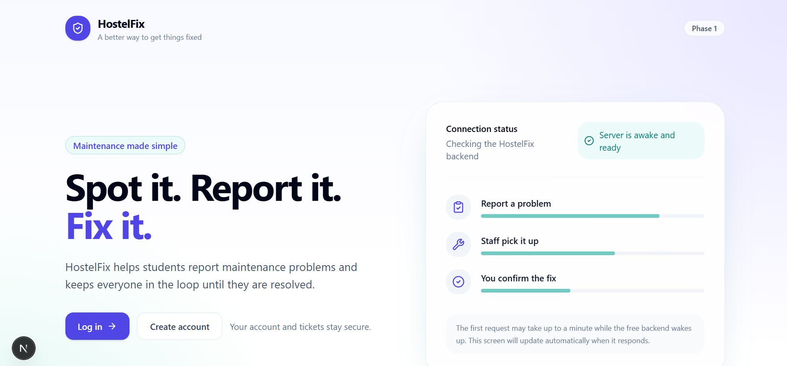
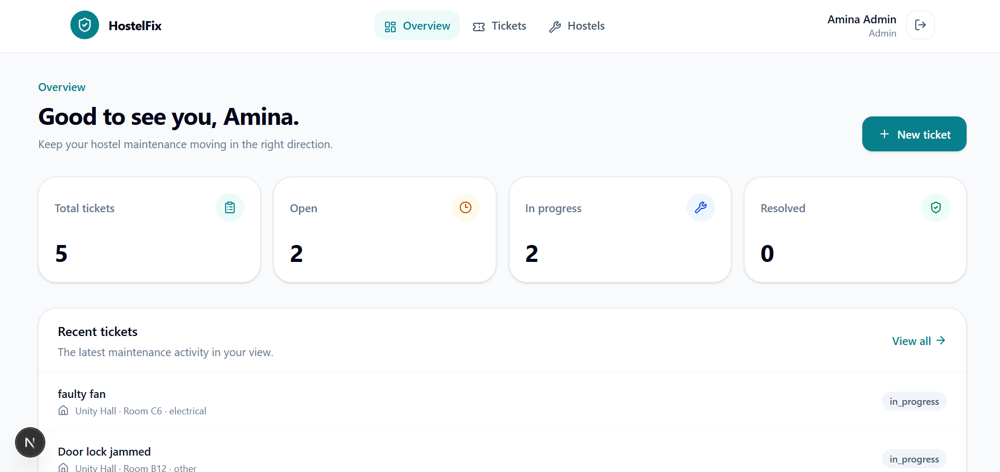
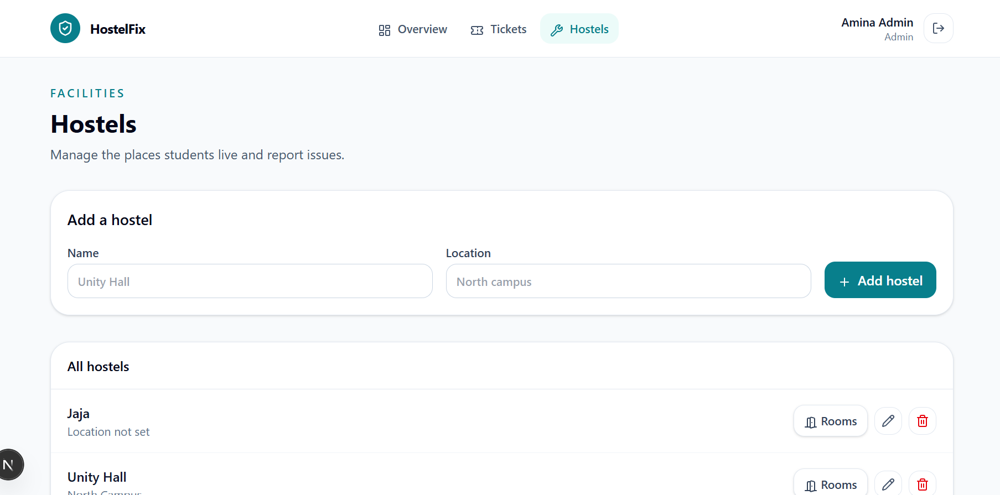
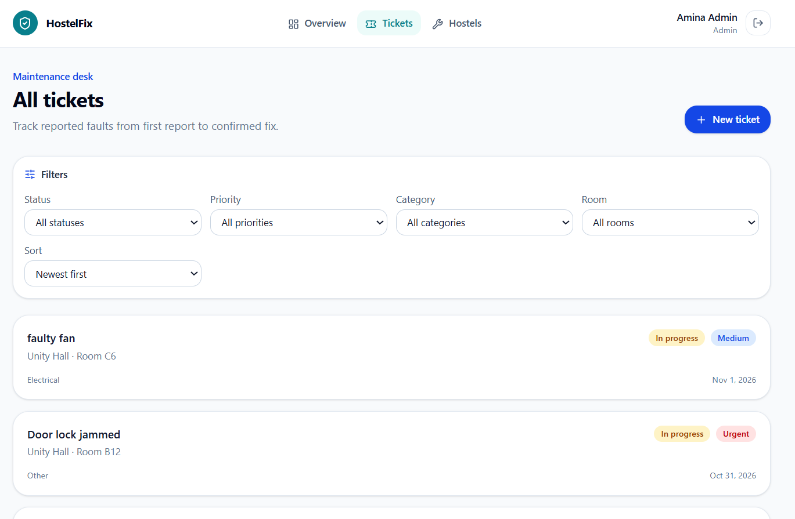
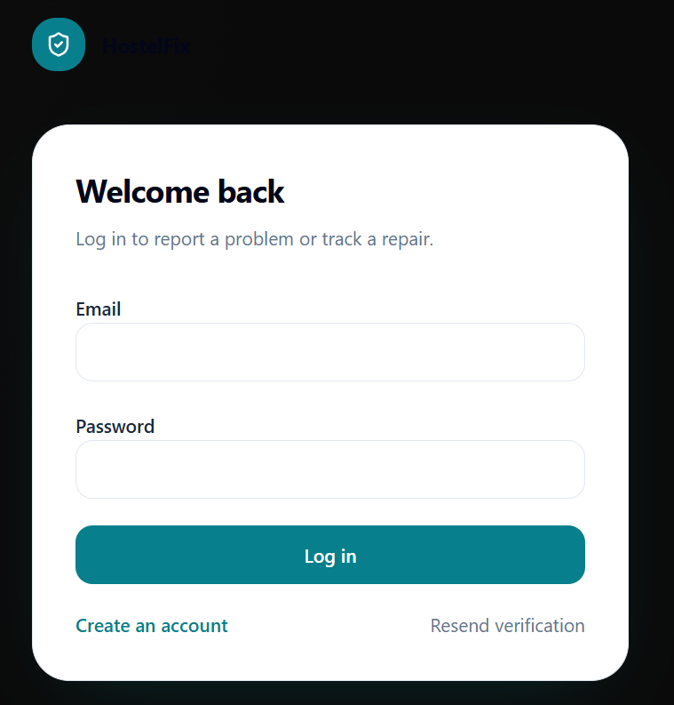

# HostelFix – Frontend

A web application for managing hostel accommodation and maintenance requests. HostelFix provides an interface for students and hostel administrators to manage hostel information, rooms, and maintenance tickets.

This repository contains the frontend application, built with Next.js, React, and TypeScript.

## Related Repository

- **Frontend:** [HostelFix-Frontend](https://github.com/Ajibzrahz/HostelFix-Frontend)
- **Backend:** [HostelFix](https://github.com/Ajibzrahz/HostelFix)

## Overview

HostelFix is designed to simplify hostel maintenance management by providing a centralized platform where users can access hostel information and manage maintenance-related requests.

The frontend communicates with a separate REST API built with Express.js. Authentication is handled through HTTP-only cookies, while the application retrieves authenticated user information from the backend.

## Features

- **Authentication:** User registration and login.
- **Session management:** Authentication using HTTP-only cookies and session verification.
- **Dashboard:** Overview of hostel-related information.
- **Hostel management:** View available hostels.
- **Room management:** View rooms associated with individual hostels.
- **Maintenance tickets:** Create, view, and manage maintenance requests.
- **Ticket updates:** View ticket details and access ticket editing functionality.
- **Role-aware interface:** Display application functionality according to the authenticated user's role.
- **API integration:** Communicate with the backend through Next.js rewrites.

## Screenshots

### Landing Page


### Dashboard


### Hostels and Rooms


### Maintenance Tickets


### Login


## Technology Stack

| Technology | Purpose |
|---|---|
| Next.js 16 | React framework and application routing |
| React 19 | User interface development |
| TypeScript | Static type checking |
| Tailwind CSS 4 | Styling |
| TanStack Query | Server-state management |
| React Hook Form | Form management |
| Zod | Schema validation |
| Base UI | Accessible UI primitives |
| Lucide React | Icons |
| Sonner | Toast notifications |
| pnpm | Package management |

## Project Structure

```text
hostelfix-frontend/
├── app/
│   ├── (protected)/
│   │   ├── dashboard/
│   │   ├── hostels/
│   │   │   └── [id]/
│   │   │       └── rooms/
│   │   ├── tickets/
│   │   │   ├── new/
│   │   │   └── [id]/
│   │   │       └── edit/
│   │   └── layout.tsx
│   ├── login/
│   ├── register/
│   ├── globals.css
│   ├── layout.tsx
│   └── page.tsx
├── components/
│   ├── ui/
│   ├── app-header.tsx
│   ├── auth-forms.tsx
│   ├── auth-provider.tsx
│   ├── hostel-ui.tsx
│   ├── query-provider.tsx
│   ├── server-health.tsx
│   ├── ticket-form.tsx
│   └── ticket-ui.tsx
├── lib/
│   ├── api.ts
│   ├── auth.ts
│   ├── tickets.ts
│   └── utils.ts
├── public/
│   └── screenshots/
│       ├── landing-page.png
│       ├── dashboard.png
│       ├── hostel-rooms.png
│       ├── maintenance-tickets.png
│       └── login.png
├── .env.example
├── .gitignore
├── next.config.mjs
├── package.json
├── pnpm-lock.yaml
└── tsconfig.json
```

## Prerequisites

Before running the application, ensure you have:

- Node.js installed.
- pnpm 12.3.4.
- Git.
- The HostelFix backend running or accessible.

## Getting Started

### 1. Clone the repository

```bash
git clone https://github.com/Ajibzrahz/HostelFix-Frontend.git
```

### 2. Navigate into the project

```bash
cd HostelFix-Frontend
```

### 3. Install dependencies

```bash
pnpm install
```

### 4. Configure environment variables

Create a `.env.local` file in the project root.

```env
BACKEND_URL=http://localhost:YOUR_BACKEND_PORT
```

Replace `YOUR_BACKEND_PORT` with the port configured for your running backend.

The backend URL is used by Next.js to proxy API requests to the Express server.

### 5. Start the development server

```bash
pnpm dev
```

Open [http://localhost:3000](http://localhost:3000) in your browser.

## Backend Integration

HostelFix uses a separate Express.js backend.

The frontend communicates with the backend through the following rewrite configuration:

```javascript
async rewrites() {
  const backend = process.env.BACKEND_URL;

  return [
    {
      source: "/api/v1/:path*",
      destination: `${backend}/api/v1/:path*`,
    },
    {
      source: "/backend-health",
      destination: `${backend}/health`,
    },
  ];
}
```

This allows frontend requests to use relative API paths while Next.js forwards them to the backend.

The API utility in `lib/api.ts` handles:

- HTTP requests and JSON serialization.
- Cookie credentials.
- API response handling.
- Centralized error handling.
- User-friendly error messages.

## Authentication

Authentication is managed through the backend.

The application uses:

- HTTP-only cookies for access and refresh tokens.
- Backend session validation.
- The `/api/v1/auth/me` endpoint to retrieve the currently authenticated user.
- An authentication context to manage user state on the frontend.
- Protected application routes.

User roles include:

- Student
- Staff
- Admin

The backend remains responsible for enforcing authentication and authorization. Frontend role checks are used for interface behavior and are not a substitute for backend authorization.

## Available Scripts

| Command | Description |
|---|---|
| `pnpm dev` | Start the development server |
| `pnpm build` | Create an optimized production build |
| `pnpm start` | Start the production server |

## Production Build

To create a production build:

```bash
pnpm build
```

To run the production application:

```bash
pnpm start
```

Ensure `BACKEND_URL` is configured for the deployment environment.

## Related Technologies

- [Next.js](https://nextjs.org/)
- [React](https://react.dev/)
- [TypeScript](https://www.typescriptlang.org/)
- [Tailwind CSS](https://tailwindcss.com/)
- [TanStack Query](https://tanstack.com/query/latest)
- [Express.js](https://expressjs.com/)

## Author

**Raheem Ajibona**

GitHub: [@Ajibzrahz](https://github.com/Ajibzrahz)
